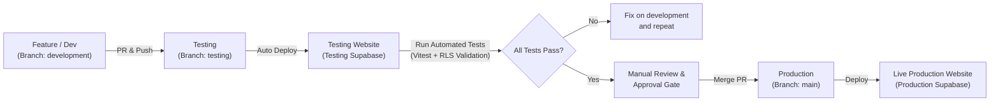

# Reddix Robotics: Testing & Production Deployment Architecture

## 1. Executive Summary & Current State Reconnaissance

Based on full codebase and infrastructure inspection:
- **Frontend:** Single Page Application (React 18 + Vite 5 + TypeScript + Tailwind CSS).
- **Hosting:** Vercel (configured via `vercel.json` pointing to `frontend`).
- **Backend & Database:** Fully integrated with Supabase (`@supabase/supabase-js`, PostgreSQL 17+, Auth, Storage, Edge Functions).
- **Current Git Status:** Working branch `supabase-migration-final`, remote `origin` at `reddixrobotics/reddix_robotics_website.git`.
- **Code Health:**
  - `npm run type-check`: **PASS (0 errors)**.
  - `npm run build`: **PASS (Vite production bundle generates cleanly)**.
  - `npm run lint`: 2,206 strict TypeScript-ESLint warnings/errors (must be tuned in CI to prevent blocking builds on legacy style warnings).
  - Testing suite: Currently **0 automated tests** configured.

```
       +--------------------------------------------------------------+
       |                  REDDIX ROBOTICS ARCHITECTURE                |
       +--------------------------------------------------------------+

  [Developer Laptop]                [GitHub Repository]
   Windows 10/11 + VS Code           Branches: development / testing / main
   Local Vite Dev Server (:5173)     CI: GitHub Actions (.github/workflows)
   Local Testing DB / Env                      |
           |                                   |
           +-----------------+-----------------+
                             |
         +-------------------+-------------------+
         |                                       |
         v                                       v
+-------------------------------+       +-------------------------------+
|     TESTING ENVIRONMENT       |       |    PRODUCTION ENVIRONMENT     |
+-------------------------------+       +-------------------------------+
| - Vercel Preview / Staging    |       | - Live Vercel Domain          |
| - Testing Supabase Account    |       | - Live Supabase Project       |
| - Dummy Students / Courses    |       | - Real Students / Orders / LMS|
| - Automated E2E & RLS Tests   |       | - Zero Manual Data Deletions  |
| - Isolated Storage Buckets    |       | - Manual Approval Gate        |
+-------------------------------+       +-------------------------------+
```

---

## 2. Three-Tier Isolated Environment Design

| Attribute | Development (`development`) | Testing / Staging (`testing`) | Production (`main`) |
| :--- | :--- | :--- | :--- |
| **Location** | Windows Laptop (VS Code) | Vercel Preview / Staging URL | Vercel Live Production URL |
| **Branch** | `development` | `testing` | `main` |
| **Supabase Project** | Testing Supabase / Local CLI | Testing Supabase (Separate Account) | **Existing Live Supabase Project** |
| **Database** | Development / Test Schema | Test DB (with dummy seeds) | **Live Production DB (UNTOUCHED)** |
| **User Base** | Local Mock Accounts | Dummy Students & Admins | Real Students, Teachers & Customers |
| **Storage Buckets**| Local / Test Buckets | Testing Buckets | Production Cloudinary / Supabase |
| **Deployment Trigger**| Local `npm run dev` | Auto-deploy on push to `testing` | **Manual Approval** on push to `main` |

---

## 3. GitHub Branching Strategy & Promotion Workflow



### Promotion Rules:
1. **Never commit directly to `main` or `testing`.** All active development happens on `development` (or feature branches branched off `development`).
2. **Promotion Step 1:** Merge `development` &rarr; `testing`.
   - Triggers GitHub Actions: type checking, automated unit/integration tests, migration validation.
   - Deploys testing preview on Vercel connected to the **Testing Supabase Project**.
3. **Promotion Step 2:** Manual QA on the testing site.
4. **Promotion Step 3:** Merge `testing` &rarr; `main` via Pull Request.
   - Requires required status checks to be green.
   - Requires explicit manual approval (GitHub Environment Reviewers).
   - Deploys to Production Vercel connected to **Production Supabase**.

---

## 4. Automated Testing Suite Architecture

We will implement a dual-layer testing architecture using **Vitest** (fastest Vite-native runner) + **React Testing Library** + **Supabase RLS Integration Tests**.

### Test Suite Structure:
```
frontend/
└── src/
    └── __tests__/
        ├── auth/
        │   ├── authFlow.test.ts          # Sign in, Sign up, Session persistence, Token refresh
        │   └── roleGuard.test.tsx        # Role-based protection (Student, Teacher, SuperAdmin)
        ├── lms/
        │   ├── studentDashboard.test.tsx # Enrolled courses, lessons, progress tracking
        │   └── adminLms.test.tsx         # Student provisioning, course builder, enrollment
        ├── security/
        │   ├── rlsIsolation.test.ts      # Student A cannot read Student B records
        │   └── adminPermissions.test.ts  # Non-admins blocked from Admin RPCs & tables
        └── functional/
            ├── formValidation.test.ts    # Checkout, Application, and Contact validation
            └── navigation.test.tsx       # Route navigation and 404 handling
```

---

## 5. Database Migration Strategy & Zero-Downtime Safety

To ensure production data is never lost or corrupted:

```
  [1. Author Migration]        -->  [2. Test on Test Supabase]
  Write versioned SQL file          Apply via Supabase CLI
  in supabase/migrations/           Verify with test student data
                                                |
                                                v
  [4. Apply to Production]    <--  [3. Migration Validation Check]
  Run via migration pipeline        Check for non-destructive syntax
  (Requires verified backup)        (no DROP TABLE / DROP COLUMN)
```

### Safety Rules:
- **No Direct Schema Edits in Production:** No ad-hoc table dropping or altering in the live dashboard.
- **Backward Compatible Migrations (Expand & Contract):**
  - Add nullable columns or columns with defaults first.
  - Never run destructive `DROP TABLE` or `DROP COLUMN` without a preceding deprecation phase.
- **Automated Backup Pre-Hook:** Before any production migration executes, run a pg_dump / Supabase automated backup point.

---

## 6. Secure Environment Variables Matrix

| Environment Variable | Local Development | Testing Deployment | Production Deployment |
| :--- | :--- | :--- | :--- |
| `VITE_SUPABASE_URL` | Testing Supabase URL | Testing Supabase URL | **Live Supabase URL** |
| `VITE_SUPABASE_ANON_KEY` | Testing Anon Key | Testing Anon Key | **Live Supabase Anon Key** |
| `SUPABASE_SERVICE_ROLE_KEY` | *Never in frontend* | GitHub Secret (Testing) | GitHub Secret (Production) |
| `VITE_APP_ENV` | `development` | `staging` | `production` |

- **Security Enforcement:** `.env`, `.env.local`, `.env.staging`, and `production/.env` are in `.gitignore`. Only `.env.example` is committed as a reference.

---

## 7. GitHub Actions CI/CD Pipeline Design

### Workflow 1: `ci.yml` (Runs on every PR and push to `development` / `testing`)
- Check out code.
- Setup Node.js 20 with cache.
- Install dependencies (`npm ci` in `frontend`).
- Run `npm run type-check`.
- Run `npm run test` (Vitest test suite).
- Run `npm run build` (Ensures bundle succeeds).
- Validate SQL migrations syntax.

### Workflow 2: `deploy-testing.yml` (Runs on push to `testing`)
- Trigger Vercel preview deployment for testing.
- Target: Testing Supabase backend.
- Run smoke tests against testing URL.

### Workflow 3: `deploy-production.yml` (Runs on push to `main`)
- Requires GitHub Environment `production` with **Required Reviewers (Manual Approval)**.
- Deploys to live production Vercel.
- Alerts team on completion.

---

## 8. Implementation Roadmap (Step-by-Step)

```
Phase 1: Environment Isolation & Secrets Setup
├── Create testing Supabase project under separate account
├── Generate .env.development and .env.testing templates
└── Configure Vercel Project Environment Variables (Production vs Preview)

Phase 2: Git Branches & Repository Setup
├── Create `development` and `testing` branches from clean main
└── Configure GitHub Branch Protection Rules (Required checks, No direct pushes)

Phase 3: Automated Testing Infrastructure
├── Install Vitest, @testing-library/react, jsdom in frontend
├── Configure vite.config.ts for test execution
└── Implement baseline tests (Auth, RoleGuard, LMS provisioning, Form validation)

Phase 4: GitHub Actions CI/CD Workflows
├── Create .github/workflows/ci.yml
└── Create .github/workflows/deploy-production.yml with manual approval gate

Phase 5: Database Migration & Verification Drills
├── Set up versioned SQL migrations directory
└── Rehearse migration pipeline on Testing Supabase first before touching Production
```
